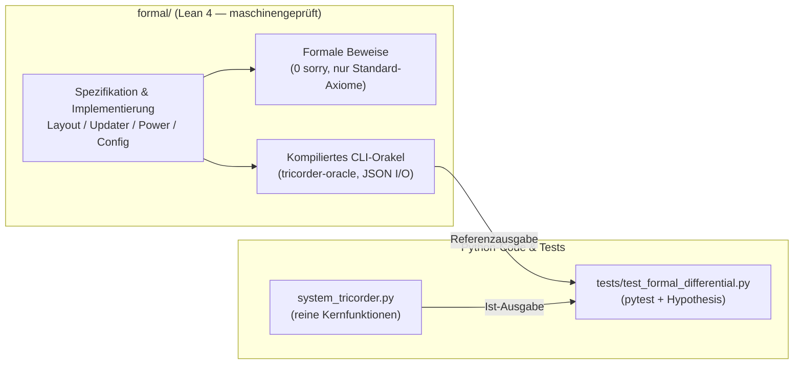

# Detaillierter Ablaufplan: Formale Verifikation von System Tricorder mit Lean 4

> **Status:** Entwurf / Arbeitsplan auf Basis von `v2.7.8` (`system_tricorder.py`, 7.892 Zeilen)  
> **Ziel:** Aufbau einer maschinengeprüften Lean-4-Verifikation (**Stufe 1: Formale Beweise + Stufe 2: Ausführbares Lean-Orakel mit Differential-/Property-Testing in CI**) ohne Laufzeit-Abhängigkeiten für Endnutzer.

---

## 1. Ausgangslage & Projekt-Randbedingungen

### Aktueller Stand im Repository
* **Architektur:** Single-File-Desktop-App in [`system_tricorder.py`](system_tricorder.py) (PyQt6, `psutil`, `ctypes` für Windows PDH/DXGI/ADLX/Version-API, `pynvml`, Linux `sysfs`/`powercap`/`fdinfo`, Windows-`.bat`-Updater).
* **Bestehende Tests:** 56 Tests in [`tests/test_smoke.py`](tests/test_smoke.py).
* **Bestehende CI ([`.github/workflows/ci.yml`](.github/workflows/ci.yml)):**
  * `lint` (`ruff` + `pyflakes`)
  * `typecheck` (`pyright`)
  * `test-native` (Windows Python 3.10–3.13, Ubuntu 3.12, macOS 3.12)
  * `test-linux-distros` (6 Docker-Distros)
  * `build-native` (PyInstaller) & `release`
* **Lean-4-Toolchain lokal:** Noch nicht installiert (`lean`, `lake`, `elan` fehlen derzeit).

### Harte Projekt-Randbedingungen (müssen eingehalten werden)
1. **Kein Einfluss auf Endnutzer-Installationen:** [`requirements.txt`](requirements.txt) und `_UPDATE_SOURCE_FILES` (`system_tricorder.py`, `requirements.txt`, `assets/SystemTricorder.png`) bleiben frei von Lean- oder Test-Abhängigkeiten.
2. **Kein schweres `Mathlib`:** Das Lean-4-Projekt nutzt bewusst nur Lean 4 Core / `Std` (`Init`, `omega`, `decide`, Listen-/Struktur-Beweise). Dadurch bleibt `lake build` bei **Sekunden statt 15–30 Minuten** und benötigt keinen Gigabyte-Cache in CI.
3. **Bestehende CI-Matrix bleibt unabhängig:** Die Windows-/macOS-/Linux-Distro-Jobs laufen weiterhin ohne `elan`/Lean; die formale Verifikation bekommt einen eigenen, schnellen CI-Job (`formal-verify`).

---

## 2. Zielarchitektur & Abgrenzung (Trusted Computing Base)

Da Lean 4 keinen Python-Code und keine `.bat`-Skripte direkt verifiziert, schließt der Plan die **Model-to-Code-Lücke** zweistufig:



### Was damit **formal bewiesen** ist (und was nicht)
* **Bewiesen (in Lean 4):**
  * Algebraische Invarianten der Layout- & Migrations-Engine (Partition, Duplikatfreiheit, Normalform, Idempotenz, Dormant-Erhalt).
  * Crash-Safety-Invarianten des Update-Protokolls (EXE-Swap & Multi-File-Source-Rollback) unter beliebigen Fehlern/Abbrüchen zwischen Einzelschritten.
  * Disjunkte Prioritäts-Tiers & Wrap-Around-Sicherheit der CPU-Leistungsberechnung (in exakter Ganzzahl-/Rational-Arithmetik).
  * Totalität und Wertebereichs-Sicherheit des Konfigurations-Sanitizers.
* **Empirisch gekoppelt (Differential-Testing via Hypothesis):**
  * Tausende generierte und gezielt konstruierte Eingaben belegen, dass Python und das bewiesene Lean-Modell identisch arbeiten.
* **Bleibt außerhalb von Lean (Trusted Computing Base / Annahmen):**
  * NTFS-/ext4-/APFS-Dateisystemsemantik, Windows-Dateisperren, Antivirus-Interferenz, `cmd.exe`-Ausführung.
  * CPython-Interpreter, GIL, PyQt6-Rendering, PyInstaller-Bootloader.
  * OS-Scheduler und Treiber-DLLs (ADLX, NVML, PDH, DXGI) — daher wird **Thread-Isolation bewusst NICHT als Scheinsicherheit in Lean 4 versprochen**, sondern auf die prüfbare Lock-Disziplin bzw. Laufzeittests beschränkt.

---

## 3. Phasenweiser Ablaufplan (Stand jetzt → Fertig)

### Phase 0: Vorarbeiten & Code-Härtung in `system_tricorder.py`
**Ziel:** Zuerst die bei der Code-Analyse gefundenen realen Lücken beheben und die reinen Funktionen sauber abgrenzen, damit Modell und Implementierung von Anfang an auf sauberer Basis stehen.

| Schritt | Konkrete Änderung in `system_tricorder.py` | Referenz |
| :--- | :--- | :--- |
| **0.1 Disk-I/O & Monotone Uhr (Linux)** | Im Linux-Loop aggregierte `rmb`/`wmb` analog zu Per-Drive und Windows mit `max(0.0, ...)` clampen; `time.time()` im Linux-Monitor-Loop (Disk-`dt` und 2s-Power-Timeout) durch `time.monotonic()` ersetzen. | `_run_linux` (`L2492–2535`) |
| **0.2 Telemetrie-Staleness-Policy klären** | Festlegen und umsetzen: (a) Soll `_latest_poll("disk")` ein `max_age` bekommen (z. B. `2.0` s oder `5.0` s), damit ein hängender Disk-Poller nicht ewig 500 MB/s anzeigt? (b) In `_SensorPoller._run` entscheiden, ob `_stamp` auf `started` (konservativ) oder `finished` gesetzt wird, und klar dokumentieren. | `_SensorPoller._run` (`L2191–2201`), `_run_windows` (`L2707`) |
| **0.3 Config-Sanitizer einführen** | Eine reine Hilfsfunktion (z. B. `_normalise_min_row_h(value, default)`) bzw. `_sanitise_config(raw)` einführen, die `min_row_h` sicher parst (kein Crash bei `"abc"`/`None`, sinnvolle Unter-/Obergrenze) statt ungeschütztem `int(cfg.get('min_row_h', ...))`. | `_load_config_file` (`L348–360`), `TileGrid.__init__` (`L4886–4887`) |
| **0.4 `TileGrid`-Guards nachziehen** | In `TileGrid.show_tile` prüfen, dass `tile_id in self._tiles` und `tile_id != '__row__'`. In `TileGrid._on_move` explizit `src == '__row__' or target == '__row__'` abweisen. | `TileGrid._on_move` (`L5075`), `show_tile` (`L5136`) |
| **0.5 PDH-Leistungs-Deduplizierung prüfen** | In `_cpu_package_power_from_pdh` klären, wie `#1`/`#2`-Instanzen behandelt werden sollen: Echte Multi-Socket-Pakete unterscheiden sich über `Package0`/`Package1` im Namen; doppelte `#N`-Instanzen identischer Namen sollten nicht unbemerkt doppelt summiert werden (Testfall + klare Regel). | `_cpu_package_power_from_pdh` (`L1379–1399`) |
| **0.6 Update-Rollback-Lücken schließen** | (a) In `_build_standalone_exe_update_bat`: `if not exist "%EXE%"` prüfen, *bevor* `del /F /Q "%BACKUP%"` läuft, damit ein älteres Backup niemals gelöscht wird, wenn `%EXE%` fehlt. (b) In `_install_staged_source_files`: im Rollback direkt `backup.replace(target)` nutzen (ohne vorgelagertes `target.unlink()`) und Fehler pro Datei protokollieren, ohne den Rollback der übrigen Dateien abzubrechen. (c) Dokumentieren, dass `_build_rebuild_bat` ein Entwickler-Checkout-Rebuild ist (oder dort ebenfalls `.previous`-Backup ergänzen). | `_install_staged_source_files` (`L5704–5710`), `_build_standalone_exe_update_bat` (`L5888–5907`), `_build_rebuild_bat` (`L5724–5837`) |
| **0.7 Regressionstests ergänzen** | Für jeden Fix 0.1–0.6 einen gezielten Test in `tests/test_smoke.py` ergänzen und lokal `pytest` + `ruff` + `pyflakes` ausführen. | `tests/test_smoke.py` |

**Ergebnis Phase 0:** Alle bekannten Edge Cases sind geschlossen, die 4 Zielmodule liegen als klar abgegrenzte, deterministische Funktionen vor.

---

### Phase 1: Lean-4-Toolchain & Projektgerüst (`formal/`)
**Ziel:** Minimalistisches, schnell bauendes Lean-4-Projekt im Unterordner `formal/` aufsetzen.

1. **Toolchain lokal installieren (Windows):**
   * `elan` installieren (offizieller Lean-Versionsmanager).
   * Eine feste, stabile Lean-4-Release-Version in `formal/lean-toolchain` pinnen (z. B. aktuelle stabile `leanprover/lean4:v4.x.y`).
2. **Projektstruktur anlegen:**
   ```text
   formal/
   ├── lean-toolchain          # Gepinnte Lean-4-Version
   ├── lakefile.toml           # Lake-Projektdefinition (Bibliothek + Oracle-Executable)
   ├── Tricorder.lean          # Root-Import aller Beweismodule
   ├── Tricorder/
   │   ├── Layout.lean         # Phase 2: Layout- & Migrations-Spezifikation + Beweise
   │   ├── Updater.lean        # Phase 3: Update-Crash-Safety-Zustandsmaschine + Beweise
   │   ├── Power.lean          # Phase 4a: Leistungs-Aggregation & RAPL-Wrap-Around
   │   ├── Config.lean         # Phase 4b: Config-Sanitizer-Totalität & Grenzen
   │   └── CheckAxioms.lean    # Automatisierter Axiom-Check (#print axioms)
   └── Oracle/
       └── Main.lean           # Phase 5: Kompilierbares JSON-CLI-Orakel
   ```
3. **`.gitignore` erweitern:**
   * `formal/.lake/` hinzufügen (Build-Artefakte gehören nicht ins Git-Repo).
4. **Smoke-Build testen:**
   * `cd formal && lake build` muss in wenigen Sekunden sauber durchlaufen.

**Ergebnis Phase 1:** Lauffähiges Lean-4-Gerüst im Repo ohne Einfluss auf Python-Builds.

---

### Phase 2: Modul 1 — Layout & Migration (`formal/Tricorder/Layout.lean`)
**Ziel:** Vollständige Formalisierung und Beweis aller Kern-Invarianten der Tile-Layout-Engine.

#### Zu modellierende Funktionen (1:1 zu `system_tricorder.py`)
* `tileRows : List String → List (List String)` (entspricht `_tile_rows`)
* `flattenTileRows : List (List String) → List String` (entspricht `_flatten_tile_rows`)
* `moveTileToNewRow : List String → String → Int → List String` (entspricht `_move_tile_to_new_row`)
* `layoutAnchor : String → Option (String × Bool)` (entspricht `_layout_anchor`)
* `mergeLayoutTiles : List String → List String → List String → List String → (List String × List String × Bool)` (entspricht `_merge_layout_tiles`)
* `preserveDormantLayout : List String → List String → List String → List String → List String → (List String × List String)` (entspricht `_preserve_dormant_layout`)

#### Formale Invarianten & zu beweisende Theoreme
1. **Kanonische Normalform (`CanonicalOrder`):**
   * Kein führendes `"__row__"`, kein abschließendes `"__row__"`, keine zwei aufeinanderfolgenden `"__row__"`.
   * Satz: `flattenTileRows (tileRows xs)` erfüllt immer `CanonicalOrder`.
   * Satz: `tileRows (flattenTileRows rows) = rows.filter (· ≠ [])`.
2. **Duplikatfreiheit & Gültigkeit nach `mergeLayoutTiles`:**
   * Alle Nicht-Sentinel-Einträge in `order` sind paarweise verschieden (`Nodup`) und liegen in `tileIds`.
   * Alle Einträge in `hidden` sind paarweise verschieden (`Nodup`), liegen in `tileIds` und enthalten kein `"__row__"`.
3. **Disjunktheit & Vollständige Partition:**
   * `visible ∩ hidden = ∅`.
   * `visible ∪ hidden = tileIds` (sofern `"__row__" ∉ tileIds`).
4. **Idempotenz von `mergeLayoutTiles`:**
   * Wenn `(o', h', _) = mergeLayoutTiles savedOrder savedHidden tileIds defaultOrder` und `tileIds` gültig/duplikatfrei ist, dann gilt:
     `mergeLayoutTiles o' h' tileIds defaultOrder = (o', h', false)`.
5. **Erhaltung bei `moveTileToNewRow`:**
   * Das Verschieben eines Tiles in eine neue Zeile erhält die exakte Menge aller sichtbaren Tile-IDs (kein Tile geht verloren, kein Duplikat entsteht) und liefert `CanonicalOrder`.
6. **Dormant-Hardware-Erhalt (`preserveDormantLayout`):**
   * Keine aktive Tile-ID wird verdoppelt oder gelöscht.
   * Jede schlafende (nicht aktive) Tile-ID aus `storedOrder ∪ storedHidden` bleibt genau einmal in `persistedOrder ∪ persistedHidden` erhalten (entweder sichtbar oder versteckt, nie beides).
   * `persistedOrder` ist in `CanonicalOrder`.

**Abnahmekriterium Phase 2:** Alle 6 Theorem-Gruppen kompiliert mit `0 sorry`.

---

### Phase 3: Modul 2 — Update-Crash-Safety (`formal/Tricorder/Updater.lean`)
**Ziel:** Maschinengeprüfte Crash-Safety-Zustandsmaschinen für die beiden transaktionalen Update-Pfade.

#### Teil A: Standalone-Windows-EXE-Update
* **Expliziter Dateisystem-Zustand `FsState`:**
  * Für jeden Slot `exe`, `backup`, `stagedNew`, `downloadedUpdate`: `Option Version` (`none`, `some .old`, `some .new`, plus optional `corrupt` vor abgeschlossener Validierung).
* **Phasen (`Phase`):**
  * `Idle → Downloading → Validating → Staging → BackingUp → Swapping → Handover → WaitingCommit → Committed` sowie `RollingBack` und `Failed`.
* **Übergangsrelation `Step : State → Event → State → Prop`:**
  * Modelliert neben den regulären Schritten explizit **Fehler- und Absturzübergänge nach jedem einzelnen Schritt**:
    * Download abgebrochen / Größe falsch / SHA-256 falsch / PE-Version falsch / Self-Test fehlgeschlagen.
    * `copy` zu `.update-new` fehlgeschlagen.
    * `move EXE → BACKUP` fehlgeschlagen (z. B. Lock/AV).
    * `move NEW → EXE` fehlgeschlagen → Rollback.
    * `start EXE` fehlgeschlagen oder neuer Prozess crasht vor 5s-Commit → `.previous` bleibt erhalten.
    * Stromausfall / Prozessabbruch an **jedem beliebigen Punkt**.
* **Zu beweisende Sicherheits-Invarianten:**
  1. **Keine zerstörte Installation (`Recoverable`):** In jedem von `Init` erreichbaren Zustand `s` gilt: Entweder enthält `s.exe` eine gültige, verifizierte Version (`old` oder `new`), **oder** `s.backup` enthält `old` (wiederherstellbar). **Niemals** gehen beide gleichzeitig verloren.
  2. **Keine unvalidierte Version in `exe`:** `s.exe = some .new` ist nur erreichbar, wenn zuvor `sizeValid ∧ sha256Valid ∧ peVersionValid ∧ selfTestPassed` galten.
  3. **Commit-Bedingung:** `s.backup` wird erst entfernt, wenn `s.exe = some .new` und der Handover/Startup-Check erfolgreich war.
  4. **Rollback-Sicherheit:** Nach einem abgeschlossenen Rollback gilt wieder `s.exe = some .old`.

#### Teil B: Multi-File-Source-Update (`_install_staged_source_files`)
* **Modell für `N` Dateien (`system_tricorder.py`, `requirements.txt`, `assets/SystemTricorder.png`):**
  * Sequenzielles Ersetzen mit Per-File-Backup und Rückwärts-Rollback bei Fehler bei Datei `k`.
* **Zu beweisende Invarianten:**
  1. **Alles-oder-Nichts bei Erfolg:** Nach Commit enthalten alle `N` Dateien die neue Version (kein Mischstand).
  2. **Sauberes Rollback bei Fehler an Index `k`:** Wenn Rollback fehlerfrei durchläuft, sind alle `N` Dateien wieder auf ihrem Vorzustand (bestehende Dateien = `old`, vorher nicht existente Dateien = `none`).
  3. **Backup-Cleanup-Isolation:** Ein Fehler beim Löschen der Backups *nach* dem Commit verändert keine Zieldatei mehr (verhindert das Zurückrollen einzelner Dateien nach Commit).

**Abnahmekriterium Phase 3:** Erreichbarkeitsbeweis per Induktion über `Reachable` mit `0 sorry`, inklusive explizit dokumentierter Liste der FS-Annahmen im Kommentar-Header.

---

### Phase 4: Modul 3 & 4 — Leistungsaufnahme & Konfiguration (`Power.lean`, `Config.lean`)
**Ziel:** Die verbleibenden zwei reinen Entscheidungsmodule mit hohem Nutzen sauber abdecken.

#### 4a. `formal/Tricorder/Power.lean`
* **Modell in `Nat` (Milliwatt / Mikrojoule):**
  * `PdhRow := (DomainClass × Nat)` mit den exakt disjunkten Prioritäts-Tiers aus `_cpu_package_power_from_pdh` (`raplPkg`, `currentSocketPower`, …, `raplCore`, `ignoredPP0Dram`).
* **Zu beweisende Theoreme:**
  1. **Kein Doppelzählen zwischen Domains:** Das Ergebnis von `cpuPackagePower rows` stammt immer aus **höchstens einer** Tier-Klasse; `PP0`/`DRAM`-Zeilen tragen niemals zum Ergebnis bei; `Core`-Zeilen tragen genau dann bei, wenn *keine* gültige Package-Zeile vorhanden ist.
  2. **Nicht-Negativität & Filterung:** Ungültige/0-Werte verändern das Ergebnis nicht; bei leerer/ungültiger Eingabe wird `none` geliefert.
  3. **RAPL-Wrap-Around (`linuxRaplDelta`):** Für `prev < maxRange` und `curr < maxRange` gilt: das berechnete Energiedelta liegt in `[0, maxRange)` und ist niemals negativ.

#### 4b. `formal/Tricorder/Config.lean`
* **Modell:**
  * `RawConfig` (beliebige optionale/fehlerhafte Strings, Zahlen, Listen, Maps) → `ValidConfig` (abhängige Struktur mit eingebetteten Beweisfeldern `minRowH ≥ 1`, `maxRowH ≥ minRowH`, gültige `Theme`-Enum, gültige `AutostartMode`-Enum, gültige Hex-Farben).
* **Zu beweisendes Theorem:**
  * **Totalität:** `sanitizeConfig : RawConfig → ValidConfig` ist eine totale Funktion (endet immer, wirft nie Fehler, garantiert alle Feld-Invarianten per Typ).
  * **Valid-Config-Idempotenz:** Bereits gültige Einstellungen bleiben unverändert erhalten (`sanitizeConfig (toRaw valid) = valid`).

**Abnahmekriterium Phase 4:** `Power.lean` und `Config.lean` bauen mit `0 sorry`.

---

### Phase 5: Ausführbares Lean-Orakel & Differential-Testing
**Ziel:** Die Model-to-Code-Lücke zwischen Lean 4 und `system_tricorder.py` automatisiert schließen.

1. **JSON-CLI-Orakel (`formal/Oracle/Main.lean`):**
   * Nutzt `Lean.Data.Json` (in Lean 4 Core enthalten — keine externe Dependency nötig!).
   * Liest Zeilen von JSON-Anfragen von `stdin` und schreibt JSON-Antworten auf `stdout` (ein Prozess pro Testlauf → extrem schnell, tausende Fälle in < 1 Sekunde):
     * `{"op": "layout_merge", ...}`
     * `{"op": "layout_dormant", ...}`
     * `{"op": "layout_move", ...}`
     * `{"op": "power_pdh", ...}`
     * `{"op": "config_sanitize", ...}`
     * `{"op": "updater_simulate", ...}`
2. **Differential- & Property-Testsuite (`tests/test_formal_differential.py`):**
   * Verwendet `pytest` + `hypothesis` (nur als Dev-/CI-Test-Dependency, **nicht** in `requirements.txt`).
   * Prüft für **jeweils 500–2.000 generierte Eingaben pro Funktion**:
     * `python_result == lean_oracle_result` (exakte Gleichheit!).
     * Alle Invarianten zusätzlich direkt auf dem Python-Ergebnis (z. B. Idempotenz, Disjunktheit, Normalform).
   * Für den Updater: Simuliert zufällige Fehler-/Crash-Sequenzen in einem echten `tmp_path`-Dateisystem (via Monkeypatch auf Dateisystem-Operationen in `_install_staged_source_files` und über statische/simulierte Trace-Prüfung der generierten `.bat`-Schritte) und vergleicht den erreichten Dateizustand gegen das Lean-Crash-Modell.
3. **Saubere Abwärtskompatibilität für lokale Python-Entwicklung:**
   * Ist das kompilierte Binary `formal/.lake/build/bin/tricorder-oracle` nicht vorhanden, werden die Oracle-Vergleichstests sauber mit `pytest.skip(...)` übersprungen, während die reinen Hypothesis-Property-Tests trotzdem laufen können.

**Abnahmekriterium Phase 5:** Alle Differential-Tests laufen gegen Python grün; absichtliche Mutationen im Python-Code (z. B. Entfernen einer Deduplizierung) werden vom Differential-Test sofort rot gemeldet.

---

### Phase 6: CI-Integration & Axiom-Wächter
**Ziel:** Dauerhafte Absicherung bei jedem Push und Pull Request, ohne bestehende Workflows auszubremsen.

1. **Axiom-Check (`formal/Tricorder/CheckAxioms.lean`):**
   * Führt `#print axioms` für alle Haupttheoreme aus.
   * Ein kleines CI-Skript prüft, dass weder `sorryAx` noch benutzerdefinierte Axiome auftauchen (nur Lean-Standard-Axiome wie `propext`, `Quot.sound`, `Classical.choice`).
2. **Neuer Job `formal-verify` in `.github/workflows/ci.yml`:**
   * Läuft auf `ubuntu-latest` (parallel zu `test-native` / `test-linux-distros`).
   * Schritte:
     1. `elan` installieren (gecacht via `actions/cache` auf `formal/lean-toolchain`).
     2. `cd formal && lake build` (kompiliert alle Beweise + `tricorder-oracle`).
     3. Axiom- und `sorry`-Prüfung.
     4. Python 3.12 + `pytest` + `hypothesis` + `requirements.txt` installieren.
     5. `QT_QPA_PLATFORM=offscreen python -m pytest tests/test_formal_differential.py -v`.
3. **Dokumentation:**
   * Kurzer Abschnitt in `README.md` (oder Verweis auf `formal/README.md`), der genau erklärt, **was** formal bewiesen ist, **wie** man es lokal ausführt, und **was** außerhalb der TCB liegt (ehrlich und überprüfbar).

**Abnahmekriterium Phase 6:** Alle bestehenden CI-Jobs + der neue Job `formal-verify` laufen komplett grün.

---

## 4. Typische Risiken & Gegenmaßnahmen

1. **Risiko: Imperative Python-Schleifen lassen sich schwer in Lean beweisen.**  
   *Gegenmaßnahme:* In Lean zuerst funktional/rekursiv über Hilfsfunktionen (`List.foldl`, strukturelle Rekursion) formulieren; das Differential-Test-Orakel stellt sicher, dass das funktionale Lean-Modell exakt dieselben Ausgaben wie die imperative Python-Schleife erzeugt.
2. **Risiko: Drift zwischen `system_tricorder.py` und `formal/`.**  
   *Gegenmaßnahme:* Genau dafür existiert Phase 5 + 6 — sobald jemand in Python die Layout- oder Power-Logik ändert, ohne das Lean-Modell anzupassen, schlägt `formal-verify` in CI sofort an.
3. **Risiko: `Float`-Semantik im Leistungsmodul.**  
   *Gegenmaßnahme:* In `Power.lean` strikt mit exakten ganzen Zahlen (Milliwatt / Mikrojoule) rechnen; im Differential-Test Python-Werte auf Milliwatt skalieren bzw. exakte Int-Inputs verwenden.
4. **Risiko: Zu großer Scope am Anfang.**  
   *Gegenmaßnahme:* Strikt inkrementell vorgehen — nach Phase 2 (`Layout.lean` + Oracle + CI) hat das Repo bereits einen kompletten, produktiven End-to-End-Verifikations-Loop. Danach folgen `Updater.lean`, `Power.lean` und `Config.lean` nach demselben Muster.

---

## 5. Checkliste „Definition of Done“

- [x] **Phase 0:** Alle 6 identifizierten Python-Edge-Cases behoben und durch Regressionstests in `tests/test_smoke.py` abgedeckt.
- [ ] **Phase 1:** `formal/` mit gepinnter `lean-toolchain` und `lakefile.toml` (ohne Mathlib) baut lokal sauber.
- [ ] **Phase 2:** `Layout.lean` beweist Partition, Disjunktheit, Duplikatfreiheit, `CanonicalOrder`, Idempotenz und Dormant-Round-Trip ohne `sorry`.
- [ ] **Phase 3:** `Updater.lean` beweist Crash-Safety-Recoverability für Standalone-EXE- und Multi-File-Source-Updates ohne `sorry`.
- [ ] **Phase 4:** `Power.lean` und `Config.lean` beweisen Domain-Disjunktheit, RAPL-Wrap-Around und Config-Totalität ohne `sorry`.
- [ ] **Phase 5:** `tricorder-oracle` läuft im `pytest`+`hypothesis`-Differential-Test gegen `system_tricorder.py` ohne Abweichungen.
- [ ] **Phase 6:** CI-Job `formal-verify` läuft auf GitHub Actions grün (inkl. Axiom-/No-`sorry`-Prüfung), bestehende Release-Builds und `requirements.txt` bleiben unverändert.
