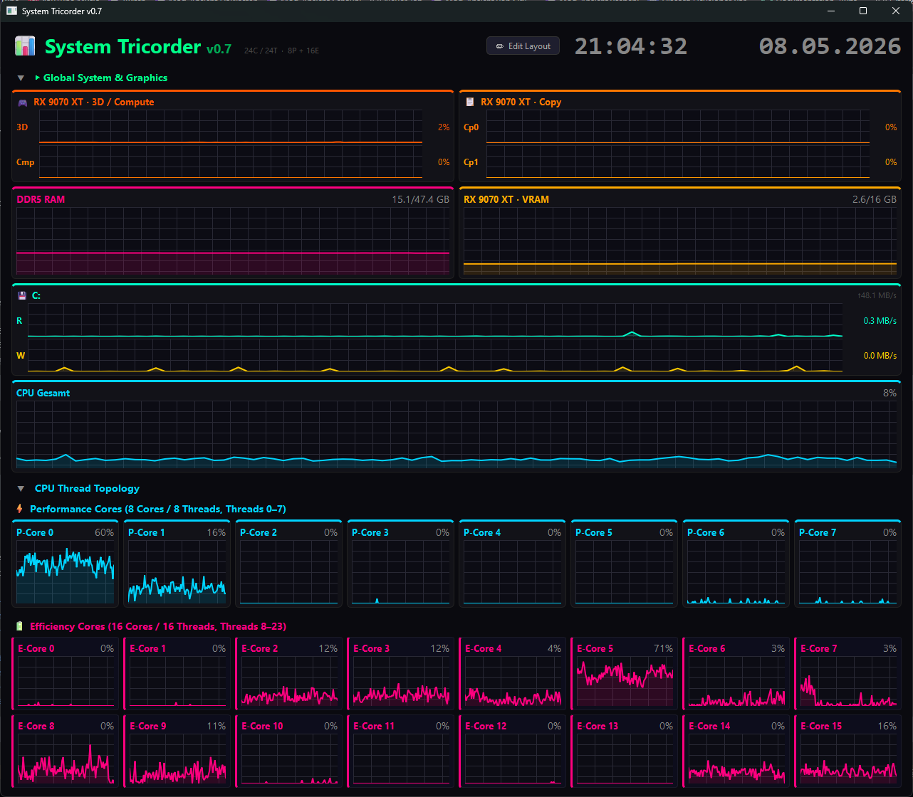

# 📊 System Tricorder

> Real-time hardware monitoring dashboard for Windows, macOS, and Linux — 30 FPS, Light/Dark mode, system tray, cross-platform autostart, and a freely customisable tile layout.




## ✨ Overview

System Tricorder monitors CPU load and per-thread topology, RAM, discrete and integrated GPUs, CPU/GPU power draw, and per-drive disk I/O at 30 FPS.

Tiles can be rearranged into arbitrary rows, recoloured individually, hidden, or restored, and sections can be collapsed. Layout, colours, theme, window geometry, tray, and autostart preferences are stored in `~/.tricorder_layout.json`.

## 🚀 Installation

Prebuilt packages for Windows, macOS, Ubuntu, Fedora, Arch Linux, Linux Mint, CachyOS, Kali Linux, and Debian are available on [GitHub Releases](https://github.com/DaWasteh/System-Tricorder/releases). Extract `.tar.gz` archives before running `SystemTricorder`. Unsigned macOS builds may require **right-click → Open** on first launch.

### Run from source

```bash
git clone https://github.com/DaWasteh/System-Tricorder.git
cd System-Tricorder
python3 -m venv .venv
# Windows PowerShell: .venv\Scripts\Activate.ps1
# macOS / Linux:     source .venv/bin/activate
python -m pip install -r requirements.txt
python system_tricorder.py
```

On Linux you can also launch via `./start_linux.sh`.

> **Platform telemetry:** Windows uses PDH (WDDM/VRAM/Energy Meter), AMD ADLX, NVML, and one-shot WMI/Registry inventory. Linux uses `psutil`, DRM sysfs/`fdinfo`, `powercap`/`hwmon`, `lspci`, and optional NVML. macOS currently monitors CPU, RAM, and disk I/O via `psutil`.

### Build a native package locally

```bash
python -m pip install -r requirements.txt pyinstaller
python .github/scripts/build_release.py --slug local
```

The built package is written to `release/`.

## ⚙️ System Tray, Autostart & CLI Flags

Click **⚙ Optionen** in the toolbar (or right-click the tray icon → **Optionen…**) to configure:

- **System Tray (`minimize_to_tray` / `close_to_tray`)** — optionally hide System Tricorder to the system tray when minimizing and/or when clicking the window close button (**×**). Left-clicking or double-clicking the tray icon restores the window; right-clicking opens show/hide, **Optionen…**, and **Beenden**.
- **Autostart on Login** — registers a per-user login entry without administrator rights:
  - **Windows:** `HKCU\Software\Microsoft\Windows\CurrentVersion\Run` (`SystemTricorder`, uses `pythonw.exe` when running from source)
  - **Linux:** `${XDG_CONFIG_HOME:-~/.config}/autostart/system-tricorder.desktop`
  - **macOS:** `~/Library/LaunchAgents/com.dawasteh.system-tricorder.plist`
- **Autostart Start Mode:**
  - **Normal** — restores the last saved window position and size
  - **Maximiert** (`--start-maximized`) — starts maximized
  - **Minimiert** (`--start-minimized`) — starts directly in the system tray if tray minimization is enabled, otherwise starts minimized in the taskbar

Supported startup flags: `--start-normal`, `--start-maximized` (`--maximized`), `--start-minimized` (`--minimized`), and `--start-tray`.

## 🎛️ Customising the Layout

Click **✏ Edit Layout** to rearrange tiles:

| Action | Control |
|--------|---------|
| Reorder tile | Drag onto the left or right half of another tile |
| Create new row | Drag onto a `── new row ──` bar between rows, or click **↵** on a tile |
| Append to row | Drag onto the `+` zone at the end of a row |
| Hide / restore tile | Click **×** on a tile / use **＋ Add Tile** |
| Tile colour | Right-click any tile in edit mode (spectrum, RGB, HEX, or reset) |
| Row height / reset | **‹ / ›** adjusts minimum row height; **↺ Reset** restores defaults |

The **Darkmode / Lightmode** dropdown in the header switches themes immediately. Clicking a section header collapses or expands that section.

### In-app updates (**⬇ Update**)

| Installation | Behaviour |
|--------------|-----------|
| Git checkout | Checks GitHub and updates via `git pull --ff-only --autostash` (rebuilds checkout EXE on Windows when needed) |
| Standalone Windows EXE | Downloads `SystemTricorder-windows-x86_64.exe`, verifies size, SHA-256, file version and `--self-test`, then replaces and restarts with rollback backup |
| Standalone Python | Downloads verified `system_tricorder.py`, `requirements.txt`, and runtime icon from the latest release tag atomically |

Your `~/.tricorder_layout.json` is never overwritten by updates.

## 📐 Monitored Metrics

### Global Grid

| Tile | Metric | Source |
|------|--------|--------|
| CPU Gesamt | Total CPU utilisation | psutil |
| CPU · Leistungsaufnahme | CPU package/socket power (W) | Windows Energy Meter/RAPL; Linux powercap |
| DDR4 / DDR5 RAM | Used / total memory | psutil (+ WMI type detection on Windows) |
| iGPU | Integrated GPU utilisation | Windows PDH; Linux DRM/sysfs |
| GPU N · GPU | Overall driver-native GPU load | AMD ADLX / NVML / DRM |
| GPU N · 3D / Compute | Separate 3D and Compute sparklines | Windows PDH; Linux DRM fdinfo |
| GPU N · Copy | Copy Engine 0 + Copy Engine 1 | Windows PDH; Linux DRM fdinfo |
| GPU N · Video Codec | Video decode/encode utilisation | Windows PDH; Linux DRM fdinfo / NVML |
| GPU N · VRAM | Used / total VRAM | ADLX / NVML / PDH / sysfs |
| GPU N · Leistungsaufnahme | Board / chip power (W) | AMD ADLX; NVIDIA NVML; Linux hwmon |
| Drive X | Per-drive Read + Write MB/s (auto-scales to GB/s) | psutil |

### CPU Thread Topology

- **Intel Hybrid (P+E cores):** separate responsive grids for P-Cores and E-Cores
- **HT / SMT:** physical core and logical sibling paired in aligned columns
- **Single-thread cores:** uniform responsive grid

## 🗂️ Configuration (`~/.tricorder_layout.json`)

```json
{
  "version": "1.0",
  "theme": "dark",
  "minimize_to_tray": true,
  "close_to_tray": true,
  "autostart": true,
  "autostart_mode": "minimized",
  "min_row_h": 75,
  "tile_order": [
    "cpu_total", "ram", "cpu_power",
    "__row__",
    "gpu_0_total", "gpu_0_3d", "gpu_0_copy", "gpu_0_codec", "gpu_0_vram", "gpu_0_power",
    "__row__",
    "igpu",
    "__row__",
    "drive_PhysicalDrive0", "drive_PhysicalDrive1"
  ],
  "hidden_tiles": [],
  "tile_colors": {
    "cpu_total": "#8a5cff"
  }
}
```

Deleting `~/.tricorder_layout.json` resets all settings and saved window geometry.

## 🔬 Formal Verification (Lean 4)

Core algorithmic and transactional logic — tile layout & migration, standalone EXE & multi-file updater crash-safety, CPU power domain aggregation / RAPL wrap-around, and configuration sanitization — is formally specified and machine-checked in Lean 4 under [`formal/`](formal/README.md) (26 theorems, 0 `sorry`, standard axioms only) and coupled to `system_tricorder.py` via an executable Lean JSON oracle and Hypothesis differential tests in [`tests/test_formal_differential.py`](tests/test_formal_differential.py).

End-user packages and `requirements.txt` do not depend on Lean 4. See [`formal/README.md`](formal/README.md) for local build instructions and Trusted Computing Base (TCB) boundaries.

## 📋 Changelog

### v2.7.8

- **Minimize & Close to System Tray** — new options in **⚙ Optionen** hide System Tricorder to the system tray when minimizing and/or clicking **×**, with a tray icon menu to restore, open options, or quit cleanly without losing saved window placement
- **Cross-Platform Autostart** — native per-user autostart support for Windows (`HKCU\...\Run`), Linux (`~/.config/autostart/system-tricorder.desktop`), and macOS (`~/Library/LaunchAgents/com.dawasteh.system-tricorder.plist`)
- **Configurable Start Mode** — autostart (and CLI flags `--start-minimized`, `--start-maximized`, `--start-normal`, `--start-tray`) can launch normal, maximized, or minimized directly into the system tray

### v2.7.7

- **No more UI freezes under heavy load** — moved ADLX, NVML, Energy Meter, GPU memory, and disk I/O polling onto dedicated sensor threads so a stalling GPU driver no longer blocks the rest of the dashboard
- **Smooth 30 FPS under load** — switched to a precise UI timer and elevated process/sensor thread priority on Windows; fixed ADLX DLL unload for safe reconnects after driver resets

### v2.7.6

- **Per-tile custom colours** — right-click any tile in edit mode to pick a colour via spectrum/RGB/HEX or restore its default colour
- **Light & Dark mode** — live theme switcher in the header (including native Windows titlebar theming) and a responsive clock/date display

### v2.7.5

- **Standalone in-app updater** — **⬇ Update** now works for standalone Windows EXEs (SHA-256, file-version, and self-test verified with rollback) and non-Git Python installs in addition to Git checkouts

### v2.7.1 – v2.7.4

- **Scale-to-fit responsive window** — compact 640×360 minimum size without scrollbars, flicker-free resizing, High-DPI fix, and full vertical space usage when maximized/fullscreen
- **Separate GPU total & engine tiles** — fixed row-move edge cases, factory layout reset, and AMD Ryzen CPU power detection (including per-core RAPL fallback)

### v2.7

- **AMD ADLX & power telemetry** — driver-native Radeon load/VRAM, per-GPU board/chip watts (ADLX/NVML/hwmon), CPU package watts (RAPL/powercap), and removal of live WMI from the 30 FPS loop

<details>
<summary>Older releases (v0.1 – v2.1)</summary>

- **v2.1** — GPU TDR/LUID recovery, multi-GPU identical-card handling, NVIDIA TCC support, lazy WMI connect, Intel Arc detection
- **v2.0** — Custom app icon and prebuilt Windows executable
- **v1.9** — In-app **⬇ Update** button (idea by [nextscript](https://github.com/nextscript))
- **v1.8** — Linux multi-GPU (DRM sysfs/`fdinfo`/NVML) and physical-disk drive tiles
- **v1.0 – v1.1** — Video Codec Engine tile and accurate hardware-only iGPU detection
- **v0.8** — PyQt5 → PyQt6 migration
- **v0.5 – v0.7** — Free-form row layout, 30 FPS batched sparkline rendering, atomic config writes, logging
- **v0.1 – v0.4** — Initial release, multi-GPU, hybrid/HT CPU topology, collapsible sections, edit mode, per-drive tiles

</details>

## 🙏 Thanks & License

Thanks to [nextscript](https://github.com/nextscript) for the update-button idea.

MIT — do whatever you want with it.
